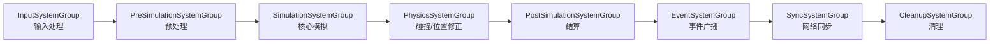

# Gbar ECS System 架构设计

> 基于 Arch.Core 的 ECS 架构，服务端逻辑主循环运行在 `ArchThread`（20-60 TPS）。
> 本文档描述 SystemGroup 分层结构、各 System 职责及与外部模块的交互方式。
>
> 关联文档：
> - [ECS 组件清单](component-checklist.md)
> - [ECS 与物理世界交互设计](ecs-physics-design.md)

---

## 一、整体架构

```
┌─────────────────────────────────────────────────────────────┐
│                         Server                               │
│  ┌──────────────┐  ┌──────────────┐  ┌──────────────┐      │
│  │ InputThread  │  │ ArchThread   │  │MonitorThread │      │
│  │  (控制台输入) │  │  (ECS 主循环) │  │  (状态监控)   │      │
│  └──────────────┘  └──────┬───────┘  └──────────────┘      │
│                           │                                  │
│                    ┌──────▼───────┐                         │
│                    │ SystemGroups │                         │
│                    │   (顺序执行)  │                         │
│                    └──────┬───────┘                         │
│                           │                                  │
│              ┌────────────┼────────────┐                    │
│              ▼            ▼            ▼                    │
│         ┌────────┐  ┌────────┐  ┌────────┐                │
│         │ 网络层  │  │ 物理层  │  │ 监控层  │                │
│         │(另一个线程)│ │(同线程只读)│ │(1 TPS) │                │
│         └────────┘  └────────┘  └────────┘                │
└─────────────────────────────────────────────────────────────┘
```

---

## 二、执行顺序



**原则**：Group 按固定顺序执行，System 在同 Group 内顺序执行。ECS 的确定性来源于此顺序。

---

## 三、SystemGroup 详解

### 1. InputSystemGroup — 输入处理
**职责**：将外部输入（网络/AI）转化为 ECS 内部可消费的 Command 或组件变更。

| System | 状态 | 职责 |
|--------|------|------|
| `PlayerInputSystem` | ⬜ | 从网络输入队列读取玩家命令，写入 `InputCommand` 组件 |
| `AIInputSystem` | ⬜ | 遍历有 `AIController` 的实体，生成移动/攻击/技能决策 |
| `CommandValidationSystem` | ⬜ | 验证输入合法性（距离、冷却、消耗），非法指令丢弃 |

**外部交互**：消费 `ConcurrentQueue<PlayerInput>`（网络线程生产）。

---

### 2. PreSimulationSystemGroup — 预处理
**职责**：每帧开始时刷新计时器、回复状态，为 Simulation 做准备。

| System | 状态 | 职责 |
|--------|------|------|
| `CooldownSystem` | ⬜ | 减少所有技能/动作的剩余冷却时间 |
| `BuffTickSystem` | ⬜ | Buff/Debuff 的周期性结算（DOT、持续回血回蓝） |
| `ManaRegenSystem` | ⬜ | 按 `Stats` 的回复速率恢复 `Mana` |
| `HealthRegenSystem` | ⬜ | 按 `Stats` 的回复速率恢复 `Health`（非战斗状态） |

---

### 3. SimulationSystemGroup — 核心模拟
**职责**：游戏主要逻辑，处理状态机、移动、战斗、技能。

| System | 状态 | 职责 |
|--------|------|------|
| `StateMachineSystem` | ⬜ | 根据当前 `State` 和输入处理状态转换（Idle→Moving→Attacking） |
| `MoveSystem` | ⬜ | 处理 `Moving` 状态，按 `MoveSpeed` 计算目标位置，调用物理验证 |
| `SkillCastSystem` | ⬜ | 处理 `Casting` 状态，读条完毕触发技能效果 |
| `CombatSystem` | ⬜ | 处理 `Attacking` 状态，根据 `Stats` 计算基础伤害 |
| `TargetSelectSystem` | ⬜ | AI/玩家自动选择目标，写入 `Target` 组件 |

**MoveSystem 与物理交互**：
```csharp
var validation = collisionWorld.ValidateMove(currentPos, desiredPos);
if (validation.CanPass)
    transform = transform with { Position = desiredPos };
else
    transform = transform with { Position = validation.AdjustedPosition };
```

---

### 4. PhysicsSystemGroup — 碰撞与位置
**职责**：将 Simulation 计算的目标位置应用到实际位置，处理 AOI（Area of Interest）。

| System | 状态 | 职责 |
|--------|------|------|
| `PositionUpdateSystem` | ⬜ | 将 `MoveTarget` 确认后的位置应用到 `Transform.Position` |
| `CollisionResolveSystem` | ⬜ | 处理物理返回的修正值，解决边缘穿插 |
| `AreaOfInterestSystem` | ⬜ | 更新每个玩家的视野列表，决定后续同步范围 |

**说明**：物理世界以 **只读查询接口** 注入到 ECS 线程中，`CollisionWorld` 数据由另一线程定期更新或静态加载。

---

### 5. PostSimulationSystemGroup — 结算
**职责**：应用 Simulation 的结果，处理死亡、复活、经验等。

| System | 状态 | 职责 |
|--------|------|------|
| `DamageApplySystem` | ⬜ | 将 `CombatSystem` 计算的伤害实际应用到 `Health` |
| `DeathSystem` | ⬜ | 检测 `Health.IsDead`，将 `State` 改为 `Dead` |
| `RespawnSystem` | ⬜ | `Dead` 实体倒计时结束后重置 Health/Position/State |
| `ExperienceSystem` | ⬜ | 击杀者获得经验，升级时更新 `Stats` |

---

### 6. EventSystemGroup — 事件广播
**职责**：触发游戏事件，供其他模块（日志、任务、成就）订阅。

| System | 状态 | 职责 |
|--------|------|------|
| `EntityDeathEventSystem` | ⬜ | 实体死亡时生成 `EntityDiedEvent` |
| `StateChangeEventSystem` | ⬜ | 状态变化时广播事件 |
| `CombatEventSystem` | ⬜ | 生成伤害数字、受击反馈等事件 |

---

### 7. SyncSystemGroup — 网络同步
**职责**：将 ECS 状态变化同步给客户端。

| System | 状态 | 职责 |
|--------|------|------|
| `TransformSyncSystem` | ⬜ | `Transform` 变化同步给视野内玩家 |
| `StateSyncSystem` | ⬜ | `State` 变化同步 |
| `HealthSyncSystem` | ⬜ | `Health`/`Mana` 变化同步（合并为属性包） |
| `SpawnDespawnSyncSystem` | ⬜ | 实体进入/离开视野时同步 |

**外部交互**：生产 `SyncPacket` 到 `ConcurrentQueue<SyncPacket>`，网络线程消费发送。

**优化**：Sync TPS 可低于逻辑 TPS（如逻辑 20 TPS，同步 10 TPS），通过计数器跳过帧。

---

### 8. CleanupSystemGroup — 清理
**职责**：每帧最后执行，保证下一帧干净。

| System | 状态 | 职责 |
|--------|------|------|
| `CommandCleanupSystem` | ⬜ | 清空 `InputCommand` 组件，防止重复执行 |
| `EntityDestroySystem` | ⬜ | 真正销毁标记为待删除的实体（Arch CommandBuffer） |
| `EventCleanupSystem` | ⬜ | 清空已处理的事件队列 |

---

## 四、最小可行版本（MVP）

当前组件仅 `Transform`、`Health`、`Mana`、`Stats`、`State`，可先合并为 3 个 Group：

```
InputGroup → LogicGroup → OutputGroup
```

| Group | 包含 System | 说明 |
|-------|------------|------|
| `InputGroup` | `PlayerInputSystem` | 最小输入处理 |
| `LogicGroup` | `MoveSystem`、`CombatSystem`、`DamageApplySystem`、`DeathSystem`、`RegenSystem` | 核心逻辑全部放在这里 |
| `OutputGroup` | `SyncSystem`、`CleanupSystem` | 同步 + 清理 |

随着业务增长再拆分为 8 个 Group。

---

## 五、与外部模块的交互

### 5.1 网络同步（ECS → 网络层）

```
┌─────────────┐     ┌─────────────┐     ┌─────────────────┐
│ MoveSystem  │────▶│ SyncSystem  │────▶│ ConcurrentQueue │
│ (修改Transform)│    │ (收集Dirty)  │     │  <SyncPacket>   │
└─────────────┘     └─────────────┘     └────────┬────────┘
                                                  │
                                                  ▼
                                          ┌───────────────┐
                                          │ NetworkThread │
                                          │ (序列化+发送)  │
                                          └───────────────┘
```

- ECS 线程只**生产**同步包，不直接做网络 I/O。
- 使用 `SyncFlag` 脏标记避免全量同步。
- AOI 过滤：只同步玩家视野内的实体。

### 5.2 物理查询（ECS → 物理世界）

```
┌─────────────┐     ┌─────────────────────────┐
│ MoveSystem  │────▶│ ICollisionWorld         │
│             │     │ (RayCast / ValidateMove) │
│             │◄────│ 返回 AdjustedPosition   │
└─────────────┘     └─────────────────────────┘
```

- `ICollisionWorld` 是**只读查询接口**，数据在 ECS 线程内安全访问。
- 地形/静态障碍数据在 `ArchThread.OnStart` 时加载。
- 复杂动态物理（刚体模拟）才需要独立物理线程 + 请求-响应模式。

---

## 六、当前文件结构

```
Gbar/
├── Gbar.Core/
│   └── ECS/
│       ├── Interface/
│       │   └── ISystem.cs              # System 接口
│       ├── Components/
│       │   ├── Identity.cs             # 实体身份 (NetworkId/Kind/TeamId/Name)
│       │   ├── Transform.cs            # 位置 + 朝向
│       │   ├── Health.cs               # 生命值 (BoundedInt)
│       │   ├── Mana.cs                 # 魔法值 (BoundedInt)
│       │   ├── Stats.cs                # 属性 (Str/Agi/Int/Atk/Def/MoveSpeed)
│       │   └── State.cs                # 实体状态 (EntityState)
│       ├── SystemGroup.cs              # System 分组容器
│       └── EcsWorldManager.cs          # World 单例管理
│
├── Gbar.Server/
│   └── GameThread/
│       ├── BaseThread.cs               # 线程基类 (TPS 循环)
│       └── Threads/
│           ├── ArchThread.cs           # ECS 主线程 (待完善 SystemGroup 注册)
│           ├── InputThreads.cs         # 控制台输入线程
│           └── MonitorThread.cs        # 监控线程 (1 TPS)
│
└── docs/
    ├── component-checklist.md          # 组件清单与优先级
    ├── ecs-physics-design.md           # 物理交互设计
    └── **ecs-system-architecture.md**   # 本文档
```

---

## 七、状态图例

| 标记 | 含义 |
|------|------|
| ✅ | 已存在（组件/基础设施） |
| 🔄 | 已存在但需重构/接入 System |
| ⬜ | 待实现 |

---

## 八、待办事项

1. [ ] 在 `ArchThread.Update` 中补全 `SystemGroups` 遍历逻辑
2. [ ] 实现 `InputCommand` 等基础组件（P0）
3. [ ] 实现 `MoveSystem` + `ICollisionWorld` 接口（P0）
4. [ ] 实现 `SyncSystem` + `ConcurrentQueue<SyncPacket>`（P0）
5. [ ] 接入网络线程，实现 `PlayerInputSystem` 消费输入队列（P1）
6. [ ] 拆分 `LogicGroup` 为 `PreSimulation` / `Simulation` / `PostSimulation`（P2）
7. [ ] 实现 AOI 系统，优化同步范围（P2）
